BÁO CÁO FINAL ASSIGNMENT — INTRO TO DEVOPS

## Dự án: Lá Shop — CI/CD và Continuous Monitoring

**Sinh viên:** Hà Văn Hoàng Phú -124010124087  
**Lớp:** K24WD03  
**Giảng viên:** Phạm Trần Đức Trọng  
**Ngày nộp:** 5/11/2026

> Báo cáo này được soạn từ quá trình triển khai thực tế và các ảnh/log đã trao đổi.

## 1. Mục tiêu

Xây dựng một quy trình DevOps cho website Lá Shop: quản lý mã nguồn bằng GitHub, tự động kiểm thử và build bằng Jenkins, đóng gói qua Docker, triển khai lên VPS, giám sát bằng Prometheus/Grafana, nhận thông báo kết quả CI/CD qua Telegram và cấu hình cảnh báo khi website hoặc API mất khả dụng.

## 2. Giới thiệu hệ thống

- **Website:** https://lashop.hoangphu.click
- **API health:** https://lashop.hoangphu.click/api/health
- **Frontend:** React, Vite.
- **Backend:** Go.
- **Database:** MySQL 8.4.
- **Frontend source:** https://github.com/hoangphu11099/Lashop-Fontend
- **Backend source:** https://github.com/hoangphu11099/Lashop-Backend
- **Máy build:** Windows với Jenkins Agent `lashop-windows`, Docker Desktop và Buildx.
- **Máy chủ:** Ubuntu VPS.

### 2.1. Kiến trúc DevOps

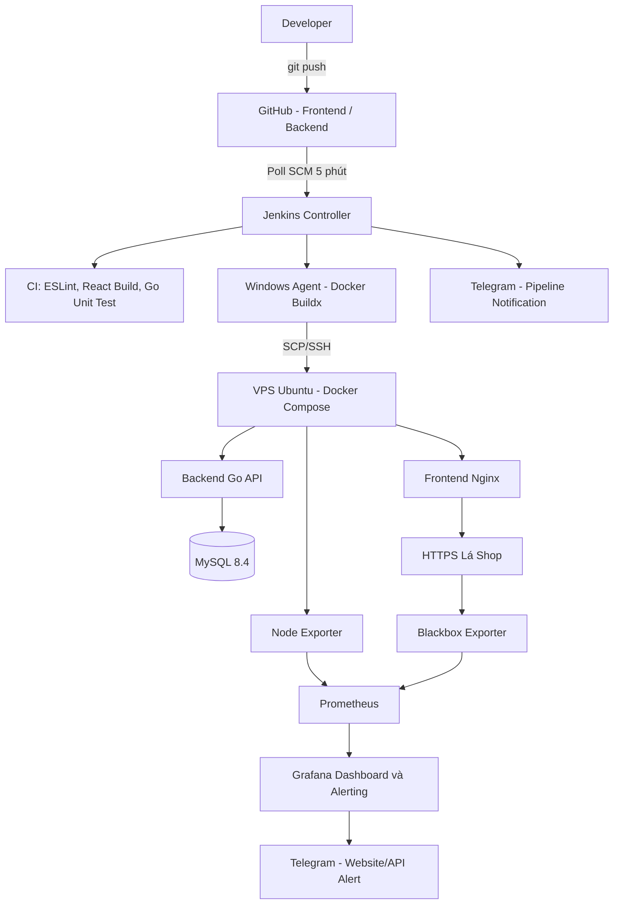

**[ẢNH 01: Sơ đồ kiến trúc tổng quan]**  
Sơ đồ Mermaid phía trên có thể hiển thị ngay trên GitHub. Nếu dùng ảnh xuất từ Mermaid, lưu `mermaid-diagram-2.png` cùng thư mục báo cáo và bỏ comment dòng sau:

<!--  -->

## 3. Docker hóa ứng dụng

Ứng dụng được chia thành 3 service trong Docker Compose: `frontend`, `backend`, `mysql`. Frontend được phục vụ qua Nginx, backend sử dụng API Go và database MySQL 8.4. MySQL sử dụng named volume để lưu dữ liệu bền vững.

Trên VPS, cấu hình production nằm tại `/var/www/lashop`, sử dụng `compose.yaml` kết hợp `compose.deploy.yaml` nhằm chọn những images `lashop-frontend:deploy` và `lashop-backend:deploy`.

Lệnh kiểm tra:

```bash
cd /var/www/lashop
docker compose -f compose.yaml -f compose.deploy.yaml config --quiet
docker compose -f compose.yaml -f compose.deploy.yaml ps
curl -fsS https://lashop.hoangphu.click/api/health
```

Kết quả đã quan sát: các container frontend, backend và MySQL chạy; MySQL healthy; health endpoint trả `{"status":"ok"}`; website HTTPS trả HTTP 200.

**[ẢNH 02: Dockerfile frontend/backend]**
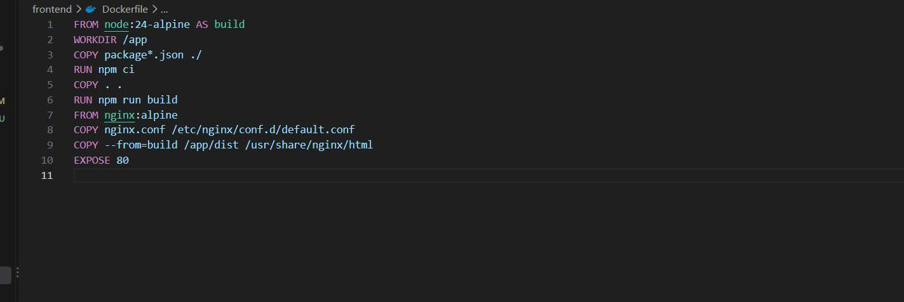
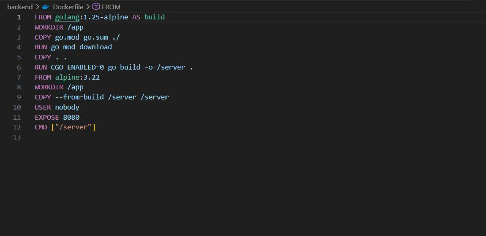
**[ẢNH 03: Docker Compose / `docker compose ps`]**
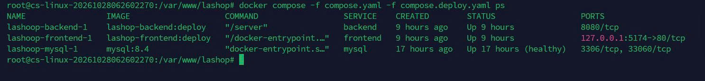
**[ẢNH 04: Website và health API]**
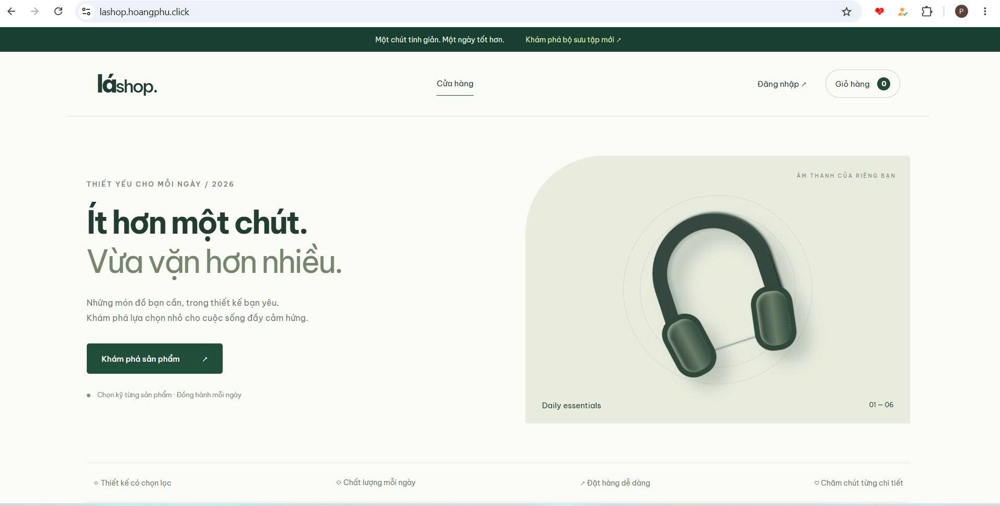
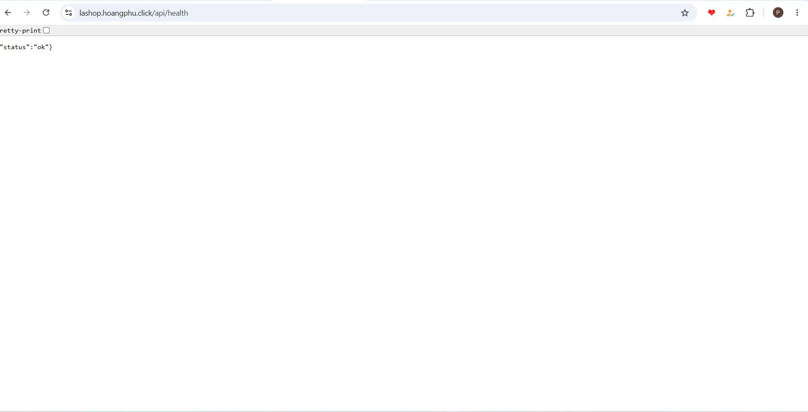

## 4. Jenkins CI/CD


### 4.1. Môi trường Jenkins

- Jenkins Controller chạy trong Docker trên Windows, truy cập qua `http://localhost:8081`.
- Windows Jenkins Agent: `lashop-windows`, kết nối qua Jenkins inbound agent.
- CI/CD Job: `LaShop-CI-CD`.
- SSH credential: quản lý trong Jenkins Credentials, không ghi khóa bí mật trong report.
- Trigger: Poll SCM với lịch `H/5 * * * *`, giúp Jenkins tự phát hiện commit mới sau `git push`.

### 4.2. Các giai đoạn Pipeline

1. Checkout mã nguồn 2 nhánh `main` từ frontend/backend repositories.
2. Frontend: `npm ci`, `npm run lint`, `npm run build`.
3. Backend: `go test ./...`, `go build ./...`.
4. Docker Buildx chạy trên Windows Agent, tạo images cho `linux/amd64`.
5. Chuyển archive images qua SSH/SCP đến VPS, cổng 24700.
6. VPS load và gán tag deploy, sau đó script `/usr/local/sbin/lashop-deploy` áp dụng Docker Compose. Script lưu image cũ để rollback khi gặp lỗi.
7. Kiểm tra kết quả deploy, gửi Telegram thông báo `SUCCESS` hoặc `FAILURE`.

Trong lần kiểm thử, Jenkins đã tự tạo build mới từ thay đổi GitHub. Kết quả build thành công và Telegram đã gửi thông báo. Cần chèn ảnh Console Output mới nhất có bước lint để chứng minh lint thật sự chạy trong Pipeline.

**[ẢNH 05: Jenkins Job + Poll SCM]**

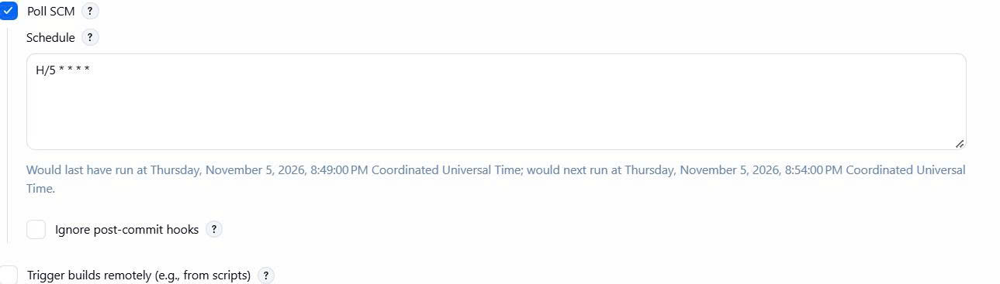
**[ẢNH 06: Console Output có npm run lint / go test]**
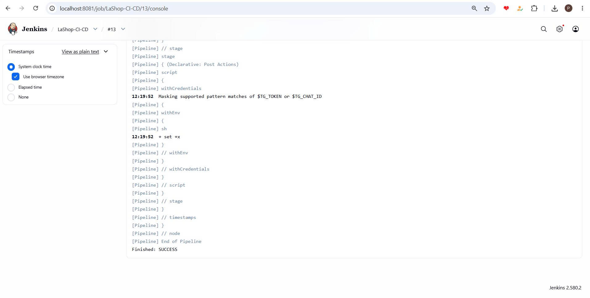
**[ẢNH 07: Docker Build + SSH deploy + Finished: SUCCESS]**
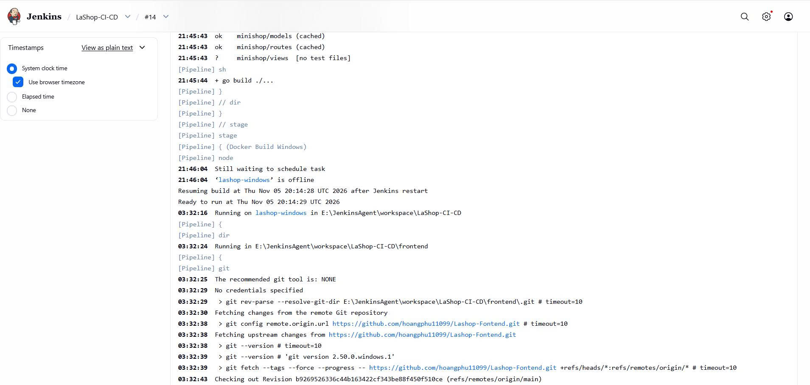
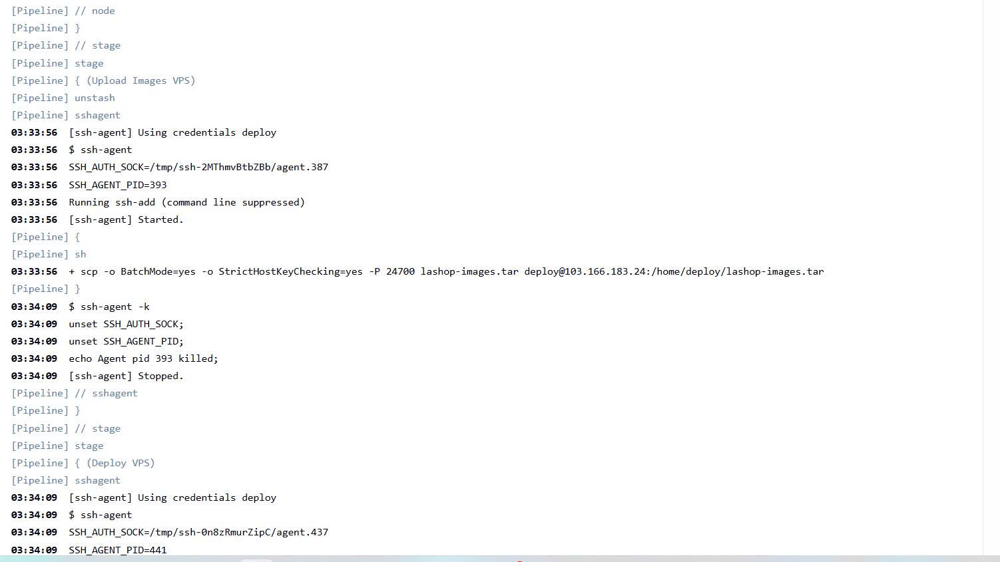
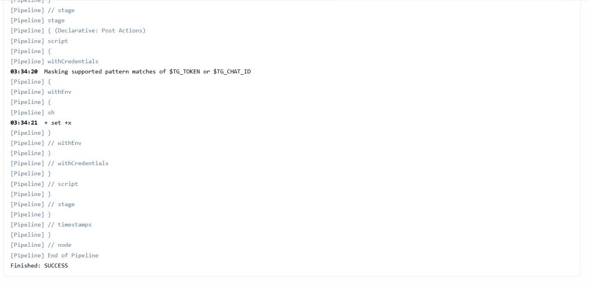

**[ẢNH 08: Telegram thông báo]**
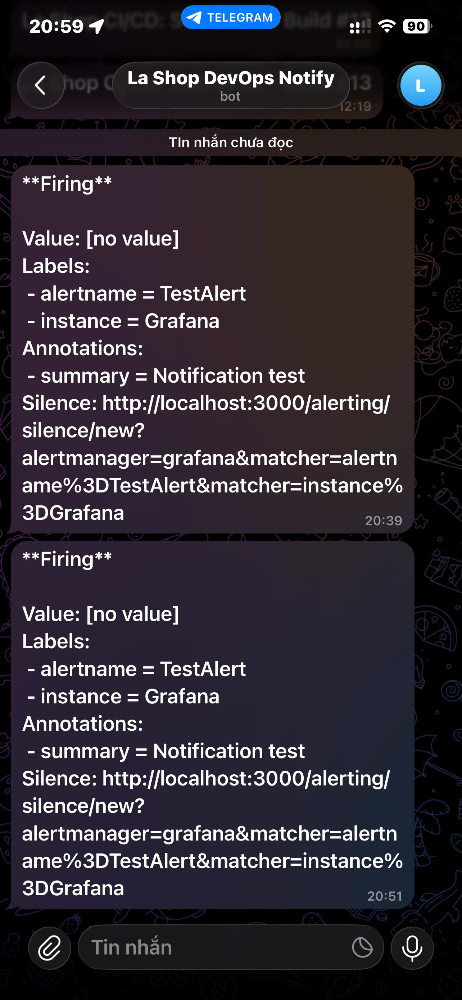

### 4.3. Lưu trữ mã nguồn Pipeline

Pipeline được lưu trong file [`Jenkinsfile`](./Jenkinsfile) của repository tài liệu. File gồm các giai đoạn Checkout Frontend/Backend, Frontend CI (ESLint, Vite build), Backend CI (Go test/build), Docker Buildx trên Windows Agent, truyền image lên VPS, deploy qua SSH, Health Check và thông báo Telegram.

Jenkins Credentials được gọi qua các ID `lashop-vps-ssh-new`, `telegram-bot-token`, `telegram-chat-id`. Đây là các **tên tham chiếu**, không phải token hay khóa bí mật. Poll SCM (`H/5 * * * *`) được cấu hình ở Jenkins Job, không nằm trong Pipeline script.

### 4.4. Phục hồi khi deploy lỗi

Script deploy trên VPS lưu image của frontend/backend đang chạy thành tag rollback trước khi cập nhật. Khi lệnh triển khai thất bại, script có logic khôi phục các tags và recreate dịch vụ. Đây là cơ chế giảm rủi ro, không thay thế backup dữ liệu database.

## 5. Monitoring liên tục

### 5.1. Thành phần

Monitoring stack được tách tại `/opt/lashop-monitoring`:

| Service           | Vai trò                              |
| ----------------- | ------------------------------------ |
| Prometheus        | Thu thập metrics theo chu kỳ 30 giây |
| Node Exporter     | Đo CPU, RAM, disk của VPS            |
| Blackbox Exporter | HTTP probe website và API health     |
| Grafana           | Dashboard trực quan hóa metrics      |

Prometheus sử dụng retention 7 ngày / giới hạn block 512MB. Grafana và Prometheus được bind loopback trên VPS, truy cập qua SSH Tunnel để tránh phơi cổng quản trị công khai.

### 5.2. Dashboard và queries

Tên dashboard: **LaShop DevOps Monitoring**.

**CPU**

```promql
100 * (1 - avg(rate(node_cpu_seconds_total{mode="idle"}[5m])))
```

**RAM**

```promql
100 * (1 - node_memory_MemAvailable_bytes / node_memory_MemTotal_bytes)
```

**Disk**

```promql
100 * (1 - node_filesystem_avail_bytes{mountpoint="/",fstype!~"tmpfs|overlay"} / node_filesystem_size_bytes{mountpoint="/",fstype!~"tmpfs|overlay"})
```

**Website / API status**

```promql
probe_success{job="lashop-website"}
```

Ảnh Dashboard cho thấy đầy đủ 4 panel: CPU, RAM, Disk và Website/API status. Trong lần kiểm tra, 2 HTTP probes có giá trị `1`, nghĩa là probe HTTP website/API thành công tại thời điểm đó.

**[ẢNH 09: Dashboard giám sát 4 panel]**
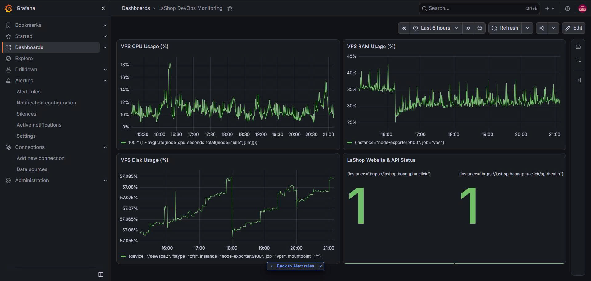

### 5.3. Cảnh báo sự cố bằng Grafana và Telegram

Grafana đã được cấu hình **Grafana-managed Alert Rule** để theo dõi trạng thái HTTP của website và API Lá Shop thông qua metric `probe_success` do Blackbox Exporter cung cấp. Hệ thống có hai chuỗi dữ liệu riêng biệt theo nhãn `instance`, tương ứng với trang chủ và API health.

| Hạng mục         | Cấu hình đã quan sát                  |
| ---------------- | ------------------------------------- |
| Rule name        | `LaShop Website Down`                 |
| Folder           | `LaShop-Alerts`                       |
| Evaluation group | `LaShop-Monitoring`                   |
| Data source      | `prometheus`                          |
| Truy vấn         | `probe_success{job="lashop-website"}` |
| Điều kiện        | `IS BELOW 1`                          |
| Pending period   | `2m`                                  |
| Keep firing for  | `0s`                                  |
| Contact point    | `LaShop-Telegram` (Telegram)          |

**Nguyên lý:** Prometheus thực hiện HTTP probe tới `https://lashop.hoangphu.click` và `https://lashop.hoangphu.click/api/health`. Giá trị `probe_success = 1` biểu thị probe thành công, còn `0` biểu thị probe thất bại. Nếu một chuỗi dữ liệu liên tục thỏa điều kiện `< 1` trong thời gian pending 2 phút, Grafana có thể chuyển alert instance tương ứng sang trạng thái **Firing** và gửi thông báo qua `LaShop-Telegram`, phụ thuộc vào việc rule được đánh giá và kênh gửi hoạt động.

**Bằng chứng đã quan sát:** Ảnh trang chi tiết rule cho thấy điều kiện `Is below 1`, hai alert instances ở trạng thái **Normal**, Pending period `2m` và Contact Point `LaShop-Telegram`. Tại thời điểm chụp, `Last evaluated` vẫn hiển thị `-`, nên ảnh đó chưa chứng minh lần đánh giá định kỳ đã chạy. Ngoài ra, Telegram Bot **La Shop DevOps Notify** đã nhận được hai thông báo kiểm thử từ Grafana, có nhãn `alertname=TestAlert`, `instance=Grafana` và nội dung `summary=Notification test`. Điều này **xác nhận kênh Grafana → Telegram gửi thông báo kiểm thử thành công**; không chứng minh website/API thực tế ngừng hoạt động hay rule `LaShop Website Down` đã tự chuyển sang Firing.

**Còn cần xác nhận:** (1) `Last evaluated` đã cập nhật sau khi rule được chạy định kỳ; (2) nếu giảng viên yêu cầu bằng chứng end-to-end, thử rule với một target kiểm thử riêng để quan sát chuyển trạng thái Firing và thông báo Telegram, không gây gián đoạn website thật.

**[ẢNH 10: Chi tiết Grafana Alert Rule — điều kiện, trạng thái và Contact Point]**  
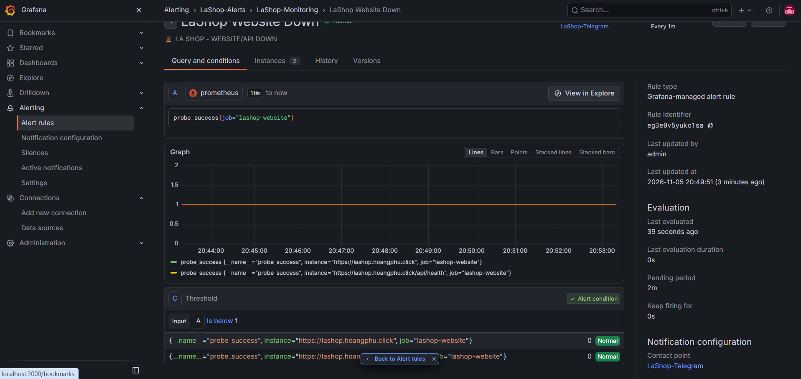

**[ẢNH 11: Thông báo kiểm thử Grafana được Telegram tiếp nhận]**  
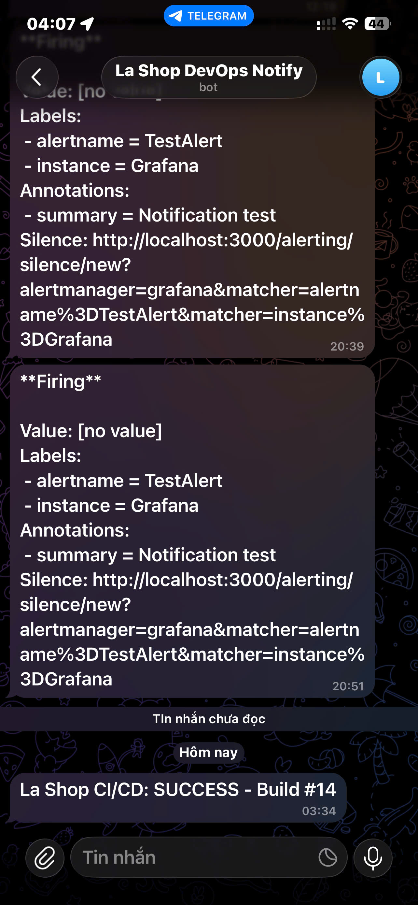

## 6. Kết quả kiểm thử

| Hạng mục        | Kết quả đã quan sát                                                                                                                                                                          | Minh chứng cần chèn                     |
| --------------- | -------------------------------------------------------------------------------------------------------------------------------------------------------------------------------------------- | --------------------------------------- |
| Frontend ESLint | `npm run lint` chạy không lỗi trên Windows                                                                                                                                                   | Log npm                                 |
| Frontend build  | `npm run build` thành công                                                                                                                                                                   | Log Vite                                |
| Go unit tests   | `go test ./...` thành công                                                                                                                                                                   | Jenkins Console Output                  |
| Docker / VPS    | frontend/backend/mysql chạy, MySQL healthy                                                                                                                                                   | Compose ps                              |
| HTTPS/API       | HTTP 200, API `status: ok`                                                                                                                                                                   | curl / website                          |
| Auto trigger    | Poll SCM phát hiện push, tự bắt đầu build                                                                                                                                                    | Build History / Polling Log             |
| Telegram        | Nhận tin pipeline hoàn tất                                                                                                                                                                   | Telegram screenshot                     |
| Monitoring      | CPU/RAM/Disk metrics; 2 probe_success = 1                                                                                                                                                    | Grafana screenshot                      |
| Grafana alerts  | Đã tạo rule `LaShop Website Down`, điều kiện `< 1` trong 2m; hai instances `Normal`. Đã nhận thông báo **TestAlert** từ Grafana trên Telegram; chưa thử cảnh báo do website/API thật bị lỗi. | Ảnh Grafana Alert Rule và Telegram Test |

## 7. Các bước tái tạo hệ thống (tóm tắt)

1. Clone cả hai repositories vào cùng workspace; chuẩn bị file `.env` dựa trên `.env.example`.
2. Kiểm tra và chạy các Docker Compose services (`docker compose config`, `docker compose up -d --build`).
3. Cài Jenkins Controller, SSH Agent plugin và Windows Agent; cấu hình GitHub URLs, Jenkins Credentials và Poll SCM.
4. Lưu Pipeline tại [`Jenkinsfile`](./Jenkinsfile) trong repository báo cáo (nếu đã copy file vào cùng thư mục). Trước khi push phải kiểm tra không có private key, mật khẩu hoặc token thật. Pipeline hiện tham chiếu bí mật qua Jenkins Credentials IDs, không đặt giá trị bí mật trực tiếp trong code.
5. Chuẩn bị VPS Ubuntu, Docker Compose và deployment script `/usr/local/sbin/lashop-deploy`; cấu hình deploy user/SSH và chỉ các quyền cần thiết.
6. Build Linux images, chuyển đến VPS, deploy bằng Compose, kiểm tra HTTPS/API.
7. Chạy monitoring stack riêng; kết nối Grafana với Prometheus, tạo Dashboard, kiểm tra HTTP probes và tạo rule `LaShop Website Down` gửi qua contact point `LaShop-Telegram`.
8. Kênh Telegram đã được thử thành công bằng TestAlert; kiểm tra thêm việc đánh giá rule định kỳ. Quay video luồng thay đổi code → Git push → Jenkins auto build → VPS update → Telegram CI/CD → Grafana Dashboard, Alert Rule và thông báo thử Grafana.

## 8. Kết luận

Dự án Lá Shop đã minh họa quy trình CI/CD từ GitHub qua Jenkins đến triển khai Docker Compose trên VPS Ubuntu; đồng thời triển khai dashboard giám sát tài nguyên, HTTP probes và cấu hình alert rule bằng Prometheus/Grafana. Việc kết hợp lint, test, build, deploy và notification hỗ trợ tự động hóa, tăng khả năng phát hiện lỗi và giảm thao tác thủ công. Phần Grafana Alerting đã được cấu hình và kênh thông báo Grafana → Telegram đã được xác nhận bằng tin nhắn kiểm thử TestAlert. Chưa có bằng chứng thực nghiệm rằng rule tự Firing khi website/API thật xảy ra sự cố.
