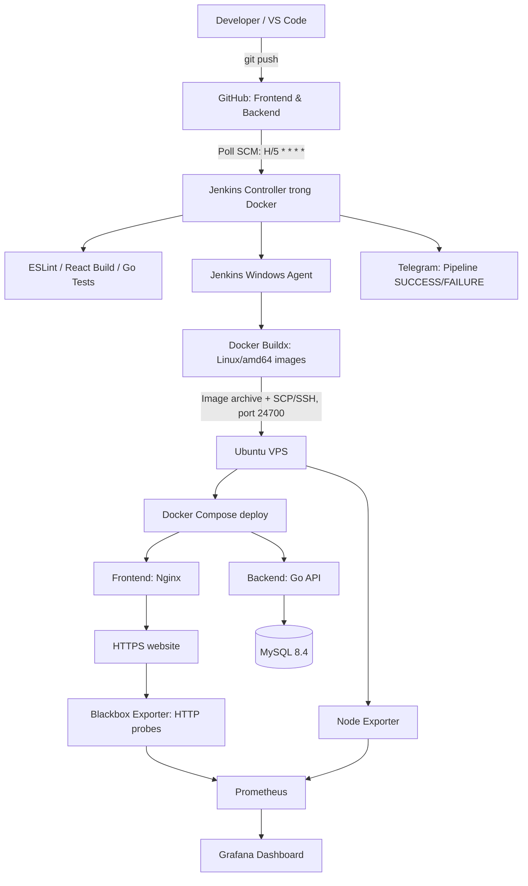

# Lá Shop — DevOps CI/CD

Dự án minh họa quy trình DevOps cuối kỳ **Intro to DevOps** với website bán hàng Lá Shop, gồm React/Vite (frontend), Go (backend) và MySQL 8.4. Quy trình CI/CD sử dụng Jenkins, Docker và VPS Ubuntu. Monitoring dùng Prometheus, Node Exporter, Blackbox Exporter và Grafana.

**Website:** https://lashop.hoangphu.click  
**Health check:** https://lashop.hoangphu.click/api/health

## Source repositories

- Frontend: https://github.com/hoangphu11099/Lashop-Fontend
- Backend: https://github.com/hoangphu11099/Lashop-Backend

## Kiến trúc tổng quan



**Quan trọng:** Trigger hiện sử dụng **Poll SCM**, không phải GitHub Webhook. Jenkins kiểm tra repository theo lịch khoảng 5 phút một lần. Jenkins Controller chạy trong Docker trên máy Windows; Windows Agent thực hiện các tác vụ Docker Buildx. Môi trường VPS được triển khai bằng Docker Compose.

## Thành phần

| Nhóm           | Công nghệ                                             | Vai trò                             |
| -------------- | ----------------------------------------------------- | ----------------------------------- |
| Frontend       | React, Vite                                           | Giao diện website                   |
| Backend        | Golang                                                | API xử lý nghiệp vụ                 |
| Database       | MySQL 8.4                                             | Lưu dữ liệu                         |
| Source control | GitHub (2 repositories)                               | Quản lý phiên bản                   |
| CI/CD          | Jenkins, Windows Agent                                | Checkout, lint, test, build, deploy |
| Container      | Docker, Docker Buildx, Docker Compose                 | Đóng gói và chạy ứng dụng           |
| Server         | Ubuntu VPS                                            | Chạy hệ thống production            |
| HTTPS          | Nginx / cấu hình HTTPS hiện có                        | Truy cập qua tên miền               |
| Monitoring     | Prometheus, Node Exporter, Blackbox Exporter, Grafana | Thu thập và trực quan hóa metrics   |
| Notification   | Telegram Bot                                          | Thông báo trạng thái Pipeline       |

## Cấu trúc dự án / hạ tầng đã sử dụng

```text
Thi/
├── frontend/
│   ├── src/
│   ├── Dockerfile
│   ├── nginx.conf
│   ├── package.json
│   ├── package-lock.json
│   └── eslint.config.mjs
├── backend/                 # Git repo riêng: Lashop-Backend
│   ├── Dockerfile
│   └── ...
├── compose.yaml
└── jenkins-tools/           # Công cụ/cấu hình Jenkins local (nếu được lưu tại đây)

# Trên VPS:
/var/www/lashop/
├── compose.yaml
├── compose.deploy.yaml
├── .env                     # KHÔNG commit
├── frontend/
└── backend/

/opt/lashop-monitoring/
├── compose.yaml
├── prometheus.yml
└── .env                     # KHÔNG commit
```

## Chạy dự án tại máy phát triển

Yêu cầu: Git, Docker Desktop và Docker Compose; Node.js/npm cho frontend, Go cho backend (nếu chạy ngoài container).

```bash
# Tại thư mục chứa 2 subfolder frontend, backend và compose.yaml:
docker compose config --quiet
docker compose up -d --build
docker compose ps
```

**Chú ý:** File `.env` bắt buộc phải được tự tạo từ `.env.example` và điền giá trị theo môi trường. Không công bố thông tin tài khoản database/admin. Cổng local tùy `compose.yaml` thực tế; cấu hình đã quan sát trước đây xuất frontend qua `127.0.0.1:5174`.

### Kiểm thử frontend

```bash
cd frontend
npm ci
npm run lint
npm run build
```

### Kiểm thử backend

```bash
cd backend
go test ./...
go build ./...
```

## Jenkins Pipeline

Tên Job: `LaShop-CI-CD`  
Jenkins local: `http://localhost:8081`  
Trigger: **Poll SCM** với lịch `H/5 * * * *`.

Các bước triển khai đã thực hiện:

1. Checkout `main` từ cả hai Git repository.
2. Cài frontend dependencies bằng `npm ci`, kiểm tra ESLint `npm run lint`, build Vite.
3. Kiểm thử Go bằng `go test ./...`, build backend.
4. Sử dụng Windows Agent để chạy Docker Buildx tạo image `linux/amd64`.
5. Chuyển Docker images qua SSH/SCP (cổng VPS `24700`); VPS load và tag các images `lashop-frontend:deploy`, `lashop-backend:deploy`.
6. Gọi script `/usr/local/sbin/lashop-deploy` từ Jenkins với quyền đã cấp cho `deploy` để cập nhật Docker Compose. Script có lưu image cũ để rollback trong trường hợp lỗi.
7. Thực hiện kiểm tra sức khỏe website/API và gửi thông báo kết quả qua Telegram.

> Jenkins Pipeline đang được cấu hình trực tiếp trong giao diện Jenkins. Để bài nộp có thể tái tạo được, hãy **xuất script đã chạy thành công thành `Jenkinsfile`** và đưa bản không chứa credentials/token lên Git repository. Tài liệu này không thay thế script triển khai thực tế.

## Production deployment

Trên VPS, hệ thống chạy các dịch vụ `mysql`, `backend`, `frontend` trong Docker Compose, sử dụng thêm `compose.deploy.yaml` để chỉ định image deploy. Kiểm tra bằng:

```bash
cd /var/www/lashop
docker compose -f compose.yaml -f compose.deploy.yaml ps
curl -fsS https://lashop.hoangphu.click/api/health
```

Health endpoint quan sát đã trả về `{"status":"ok"}`. Website HTTPS cũng đã trả về `HTTP/2 200` trong lần kiểm thử trước đây. Không thay đổi volume MySQL khi redeploy.

## Monitoring

Monitoring độc lập tại `/opt/lashop-monitoring` gồm:

- **Node Exporter:** host metrics (CPU, memory, disk).
- **Blackbox Exporter:** HTTP probes cho website và `/api/health`.
- **Prometheus:** scrape metrics mỗi 30 giây; cấu hình retention 7 ngày / giới hạn block 512MB.
- **Grafana:** dashboard `LaShop DevOps Monitoring` gồm CPU, RAM, Disk, Website/API Status.

Kiểm tra:

```bash
cd /opt/lashop-monitoring
docker compose ps
```

Grafana được map tới `127.0.0.1:3000` trên VPS và xem qua SSH tunnel từ Windows:

```powershell
ssh -i "$env:USERPROFILE\.ssh\lashop_jenkins_new" -p 24700 -N -L 3000:127.0.0.1:3000 deploy@103.166.183.24
```

Mở http://localhost:3000 trong trình duyệt. Prometheus data source bên trong Docker: `http://prometheus:9090`.

Ví dụ PromQL:

```promql
100 * (1 - avg(rate(node_cpu_seconds_total{mode="idle"}[5m])))
```

```promql
100 * (1 - node_memory_MemAvailable_bytes / node_memory_MemTotal_bytes)
```

```promql
100 * (1 - node_filesystem_avail_bytes{mountpoint="/",fstype!~"tmpfs|overlay"} / node_filesystem_size_bytes{mountpoint="/",fstype!~"tmpfs|overlay"})
```

```promql
probe_success{job="lashop-website"}
```

Đã quan sát 2 probe (`website`, `API`) trả giá trị `1`. **Chưa có bằng chứng Grafana Alerting (cảnh báo tự động khi website down) đã được cấu hình.** Thông báo Telegram hiện được xác nhận cho **Jenkins Pipeline**, không phải alert monitoring.

## Bảo mật và vận hành

- Không commit `.env`, khóa SSH, token Telegram hay mật khẩu.
- Dùng Jenkins Credentials cho SSH/Telegram; không hard-code secrets trong Pipeline.
- Giới hạn Grafana/Prometheus ở loopback, truy cập qua SSH tunnel.
- Bảo vệ dữ liệu MySQL trong named volume; sao lưu trước các thay đổi có rủi ro.
- Jenkins và Docker Desktop trên Windows cần hoạt động để Poll SCM và CI/CD thực thi. Nếu Windows tắt, deploy tự động không hoạt động.

## Minh chứng nộp bài

- [ ] Ảnh GitHub repositories và README.
- [ ] Ảnh các stage Jenkins + `npm run lint`, `go test ./...`, `Finished: SUCCESS`.
- [ ] Ảnh trigger `Poll SCM` và log tự động chạy khi push.
- [ ] Ảnh Docker Compose `ps` trên VPS.
- [ ] Ảnh website HTTPS và API health.
- [ ] Ảnh Telegram notification.
- [ ] Ảnh Grafana Dashboard 4 panels và `probe_success = 1`.
- [ ] Sơ đồ kiến trúc DevOps và tài liệu báo cáo.
- [ ] Video demo có mic/camera, upload Google Drive, chia sẻ link public.

Xem thêm `DEVOPS_REPORT.md` để có nội dung thuyết minh chi tiết.
